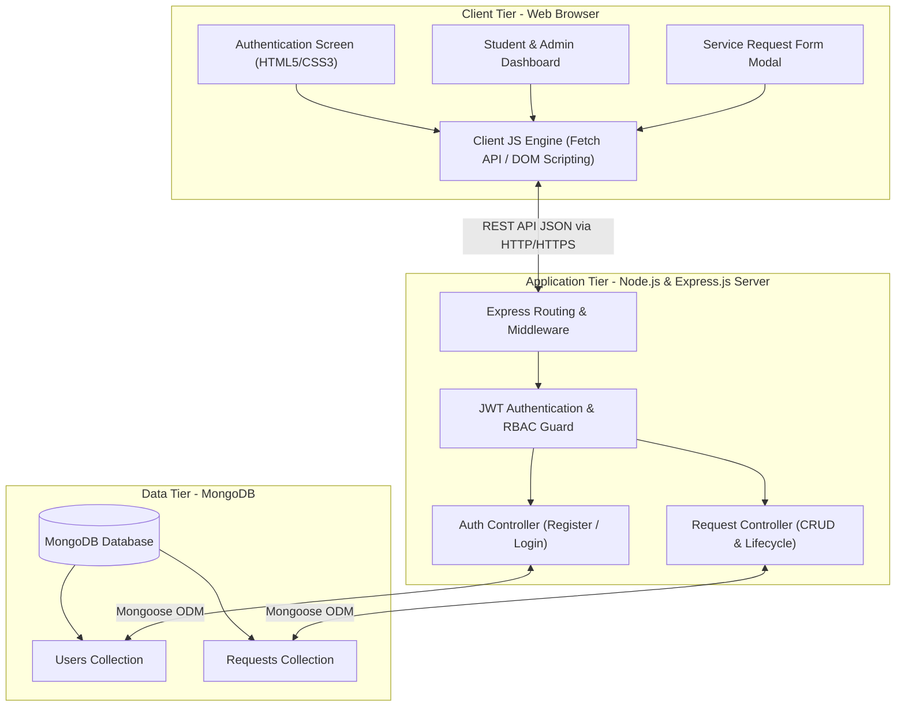

# Project Architecture Specification Document

**Project Title:** CampusDesk — Student Service Request & Grievance Redressal System  
**Internship Organization:** SWYNEX Technologies  
**Task Name:** Task 1 — Project Architecture  
**Document Version:** 1.0.0  
**Prepared For:** MCA Internship Submission  
**Author:** Safa Bhagewadi (MCA Intern)  
**Date:** October 2026  

---

## 1. Abstract

In modern higher educational institutions, students frequently encounter academic, administrative, and infrastructural challenges requiring departmental intervention. Traditional request handling relies predominantly on manual paperwork, physical queueing at office counters, or untracked emails. This leads to administrative backlogs, lack of status transparency, and delayed resolutions. 

**CampusDesk** is a robust, full-stack web application developed using a 3-tier architecture with HTML5, CSS3, JavaScript (ES6+), Node.js, Express.js, and MongoDB. The system delivers a role-based self-service portal where students can submit categorized service requests, track real-time resolution lifecycles, and receive administrative feedback. Simultaneously, campus administrators gain an organized queue to triage, assign, update, and resolve issues with complete auditability.

---

## 2. Problem Statement

Colleges and universities operate across decentralized departments (e.g., Computer Applications, Examination Cell, Accounts, Library, Hostel, and Laboratory Facilities). Currently, students face several recurring obstacles:
1. **Lack of Transparency:** Once a paper request or email is submitted, students have no mechanism to track which official is reviewing the issue or when it will be resolved.
2. **Administrative Overhead:** Staff members receive redundant complaints across multiple unstructured channels without priority categorization.
3. **Data Loss & Accountability Gaps:** Physical slips and unmonitored inbox messages get misplaced, leaving no audit trail or performance metrics regarding resolution times.

---

## 3. Project Objectives

1. **Centralize Campus Requests:** Build a single, web-based digital portal accessible across desktop and mobile devices for all student service requests.
2. **Automate Lifecycle Tracking:** Implement a 5-stage status workflow: `Pending` $\rightarrow$ `Under Review` $\rightarrow$ `In Progress` $\rightarrow$ `Resolved` $\rightarrow$ `Rejected`.
3. **Role-Based Access Control (RBAC):** Provide distinct interfaces and permissions for Students (submit and monitor own tickets) and Administrators (review all tickets, filter by department, update statuses, add remarks).
4. **Data Integrity & Security:** Enforce secure authentication using JSON Web Tokens (JWT) and Bcrypt password hashing, with strict schema validation in MongoDB.
5. **Real-time Analytics:** Furnish intuitive metric cards summarizing total, pending, and resolved issues for administrative monitoring.

---

## 4. Proposed Solution

CampusDesk introduces an end-to-end full-stack solution:
- **Presentation Layer (Frontend):** Modern, responsive, and lightweight client built using semantic HTML5, custom modern CSS3 (with responsive CSS Grid/Flexbox layouts and glassmorphic cards), and Vanilla JavaScript for dynamic DOM updates and asynchronous REST communication.
- **Application Layer (Backend):** A high-performance REST API built with Node.js and Express.js, implementing modular MVC (Model-View-Controller) routing, JWT authorization middleware, and standardized JSON responses.
- **Data Persistence Layer (Database):** MongoDB managed through Mongoose Object Data Modeling (ODM) with strict schemas, data type validations, and index optimization.

---

## 5. Technology Stack & Component Justification

| Technology | Role | Justification |
| :--- | :--- | :--- |
| **HTML5** | Frontend Markup | Semantic elements (`<header>`, `<nav>`, `<main>`, `<section>`, `<footer>`) ensure structural integrity, accessibility, and high SEO scores. |
| **CSS3** | Frontend Styling | Custom CSS with CSS variables (`--primary`, `--bg-dark`, etc.), Flexbox, CSS Grid, and micro-transitions delivers a sleek, responsive UI without the overhead of heavy third-party CSS frameworks. |
| **Vanilla JavaScript (ES6+)** | Frontend Logic | Native modern JavaScript utilizing the `Fetch API`, `async/await`, and DOM manipulation allows for high speed and zero build-step complexity. |
| **Node.js** | Backend Runtime | Non-blocking, event-driven I/O model provides fast processing of concurrent HTTP requests suitable for campus-wide user traffic. |
| **Express.js** | Web Framework | Lightweight backend framework that organizes routes, integrates middleware (CORS, body parser, authentication), and standardizes REST endpoints. |
| **MongoDB** | Database | Flexible document-oriented NoSQL database that stores data natively in JSON-compatible BSON format, matching the frontend/backend data structures seamlessly. |
| **Mongoose ODM** | Data Modeling | Provides schema enforcement, field validations, pre-save hooks (for password hashing), and intuitive query methods. |

---

## 6. System Architecture

CampusDesk implements a classic **3-Tier Architecture**:
1. **Tier 1 — Presentation Layer (Client Browser):** Runs in the user's browser, presenting UI views, collecting form inputs, executing client-side validation, and making asynchronous API requests.
2. **Tier 2 — Application / Logic Layer (Node & Express Server):** Handles incoming HTTP requests, enforces authentication/authorization, executes business logic, and prepares responses.
3. **Tier 3 — Data Layer (MongoDB Database):** Persists application state, user accounts, and request tickets securely.

### Architecture Diagram



### Communication Flow Explanation
1. **Client Request:** The user triggers an action (e.g., submitting a request). The client-side JavaScript validates fields, gathers data into a JSON object, reads the stored JWT token from `localStorage`, and dispatches an asynchronous `fetch()` request with headers `Content-Type: application/json` and `Authorization: Bearer <token>`.
2. **Server Processing:** The Express server receives the HTTP packet, parses the JSON payload with `express.json()`, and executes authentication middleware to verify the JWT signature.
3. **Controller Execution:** The route handler invokes the appropriate controller function, which performs business validation and invokes Mongoose methods.
4. **Database Transaction:** Mongoose translates the operation into a MongoDB command, executes the query/mutation, and returns the BSON document.
5. **Client Rendering:** The server dispatches an HTTP status code (`200 OK` or `201 Created`) along with the JSON payload. The client JavaScript processes the response and dynamically updates the DOM without requiring a full page reload.

---

## 7. Data Models & MongoDB Schemas

### 7.1 Users Collection (`users`)

Stores user accounts for both students and staff administrators.

#### Schema Definition
- `fullName`: `String`, required, trimmed, minlength 3, maxlength 60.
- `email`: `String`, required, unique, lowercase, trimmed, validated via regex.
- `password`: `String`, required, minlength 6 (stored as a bcrypt hash).
- `role`: `String`, required, enum: `["student", "admin"]`, default: `"student"`.
- `rollNumber`: `String`, optional for admin, required for student, uppercase.
- `department`: `String`, required, enum: `["Computer Applications", "Information Technology", "Electronics", "Mechanical", "Administration", "General"]`.
- `createdAt`: `Date`, default: `Date.now`.
- `updatedAt`: `Date`, default: `Date.now`.

#### Sample Document
```json
{
  "_id": "660c21a1f1b2c3d4e5f67890",
  "fullName": "Rahul Sharma",
  "email": "rahul.mca@college.edu",
  "password": "$2b$10$wN6pA1Z8vK3g0s8pL2t9eOa7Q8i6y4r3w2q1m9k8j7h6g5f4d3c2b1",
  "role": "student",
  "rollNumber": "MCA-2025-042",
  "department": "Computer Applications",
  "createdAt": "2026-10-16T10:00:00.000Z",
  "updatedAt": "2026-10-16T10:00:00.000Z",
  "__v": 0
}
```

---

### 7.2 Service Requests Collection (`requests`)

Stores all grievance tickets, status changes, and administrator resolution remarks.

#### Schema Definition
- `title`: `String`, required, trimmed, minlength 5, maxlength 120.
- `description`: `String`, required, trimmed, minlength 10, maxlength 2000.
- `category`: `String`, required, enum: `["Academic", "Administrative", "IT & Lab Facilities", "Hostel & Infrastructure", "Library", "Other"]`.
- `priority`: `String`, required, enum: `["Low", "Medium", "High", "Urgent"]`, default: `"Medium"`.
- `status`: `String`, required, enum: `["Pending", "Under Review", "In Progress", "Resolved", "Rejected"]`, default: `"Pending"`.
- `student`: `ObjectId`, ref: `'User'`, required (indexes the creator).
- `assignedTo`: `ObjectId`, ref: `'User'`, optional (admin user handling the ticket).
- `adminRemarks`: `String`, default: `""`, maxlength 1000.
- `createdAt`: `Date`, default: `Date.now`.
- `updatedAt`: `Date`, default: `Date.now`.

#### Sample Document
```json
{
  "_id": "660c29f4a1b2c3d4e5f67891",
  "title": "Lab 3 Network Access & Compiler Installation Issue",
  "description": "Desktop PC 14 in Lab 3 is unable to connect to the internal network repository for Node.js packages.",
  "category": "IT & Lab Facilities",
  "priority": "High",
  "status": "In Progress",
  "student": "660c21a1f1b2c3d4e5f67890",
  "assignedTo": "660c18d9a1b2c3d4e5f67888",
  "adminRemarks": "System Administrator is inspecting switch port 14 and updating local package mirrors.",
  "createdAt": "2026-10-16T10:30:00.000Z",
  "updatedAt": "2026-10-16T11:00:00.000Z",
  "__v": 0
}
```

---

## 8. REST API Routes & Specifications

### 8.1 Authentication Endpoints

#### 1. Register User
- **Method:** `POST`
- **URL:** `/api/auth/register`
- **Access:** Public
- **Request Body:**
  ```json
  {
    "fullName": "Rahul Sharma",
    "email": "rahul.mca@college.edu",
    "password": "Password@123",
    "role": "student",
    "rollNumber": "MCA-2025-042",
    "department": "Computer Applications"
  }
  ```
- **Response (`201 Created`):**
  ```json
  {
    "success": true,
    "message": "User registered successfully.",
    "token": "eyJhbGciOiJIUzI1NiIsInR5cCI6IkpXVCJ9...",
    "user": {
      "id": "660c21a1f1b2c3d4e5f67890",
      "fullName": "Rahul Sharma",
      "email": "rahul.mca@college.edu",
      "role": "student"
    }
  }
  ```

#### 2. Login User
- **Method:** `POST`
- **URL:** `/api/auth/login`
- **Access:** Public
- **Request Body:**
  ```json
  {
    "email": "rahul.mca@college.edu",
    "password": "Password@123"
  }
  ```
- **Response (`200 OK`):**
  ```json
  {
    "success": true,
    "message": "Login successful.",
    "token": "eyJhbGciOiJIUzI1NiIsInR5cCI6IkpXVCJ9...",
    "user": {
      "id": "660c21a1f1b2c3d4e5f67890",
      "fullName": "Rahul Sharma",
      "email": "rahul.mca@college.edu",
      "role": "student",
      "department": "Computer Applications"
    }
  }
  ```

---

### 8.2 Service Request Endpoints

#### 3. Fetch All Requests
- **Method:** `GET`
- **URL:** `/api/requests`
- **Access:** Protected (Students see their own; Admins see all)
- **Query Parameters:** `?status=Pending&category=Academic&priority=High`
- **Response (`200 OK`):**
  ```json
  {
    "success": true,
    "count": 1,
    "data": [
      {
        "_id": "660c29f4a1b2c3d4e5f67891",
        "title": "Lab 3 Network Access & Compiler Installation Issue",
        "category": "IT & Lab Facilities",
        "priority": "High",
        "status": "In Progress",
        "createdAt": "2026-10-16T10:30:00.000Z"
      }
    ]
  }
  ```

#### 4. Create New Request
- **Method:** `POST`
- **URL:** `/api/requests`
- **Access:** Protected (Student role only)
- **Request Body:**
  ```json
  {
    "title": "Library Book Fine Waiver Dispute",
    "description": "Book was returned on 12th Oct before 4 PM, but automated return ledger marked it overdue.",
    "category": "Library",
    "priority": "Medium"
  }
  ```
- **Response (`201 Created`):**
  ```json
  {
    "success": true,
    "message": "Service request submitted successfully.",
    "data": {
      "_id": "660c3102a1b2c3d4e5f67895",
      "title": "Library Book Fine Waiver Dispute",
      "status": "Pending",
      "createdAt": "2026-10-16T11:15:00.000Z"
    }
  }
  ```

#### 5. Update Request Status & Remarks
- **Method:** `PATCH`
- **URL:** `/api/requests/:id/status`
- **Access:** Protected (Admin role only)
- **Request Body:**
  ```json
  {
    "status": "Resolved",
    "adminRemarks": "Physical return receipt verified with librarian. Overdue fee cleared."
  }
  ```
- **Response (`200 OK`):**
  ```json
  {
    "success": true,
    "message": "Request status updated successfully.",
    "data": {
      "_id": "660c3102a1b2c3d4e5f67895",
      "status": "Resolved",
      "adminRemarks": "Physical return receipt verified with librarian. Overdue fee cleared."
    }
  }
  ```

#### 6. Delete Request
- **Method:** `DELETE`
- **URL:** `/api/requests/:id`
- **Access:** Protected (Student can delete own if still `Pending`; Admin can delete any)
- **Response (`200 OK`):**
  ```json
  {
    "success": true,
    "message": "Request deleted successfully."
  }
  ```

#### 7. Dashboard Analytics Summary
- **Method:** `GET`
- **URL:** `/api/requests/stats`
- **Access:** Protected
- **Response (`200 OK`):**
  ```json
  {
    "success": true,
    "stats": {
      "total": 18,
      "pending": 6,
      "inProgress": 4,
      "resolved": 8
    }
  }
  ```

---

## 9. Frontend Screen Planning & UI Design

### 9.1 Authentication Screen (`index.html`)
- **Header:** CampusDesk brand logo with college subtitle.
- **Form Card:** Dual-tab toggle (`Sign In` / `Register`).
- **Fields (Sign In):** Email address, Password, Login button.
- **Fields (Register):** Full Name, Email, Password, Department dropdown, Roll Number, Role selector (Student / Admin).
- **Aesthetic:** Glassmorphism card, deep blue/slate gradient backdrop, accessible high-contrast text, dynamic input focus highlights.

### 9.2 Main Application Dashboard (`dashboard.html`)
- **Navigation Bar:** App title, current user role badge, department indicator, and logout icon.
- **Metrics Bar:** 3 interactive stat cards:
  - Total Requests (Indigo)
  - Pending / Active (Amber)
  - Successfully Resolved (Emerald)
- **Toolbar:**
  - Status filter buttons (`All`, `Pending`, `In Progress`, `Resolved`).
  - Search input (searches by title or keyword).
  - Prominent CTA button: **"+ New Request"**.
- **Request Feed Grid:** Responsive cards showing:
  - Title and Category badge.
  - Priority flag (Low / Med / High).
  - Status chip (`Pending`, `In Progress`, `Resolved`).
  - Created timestamp.
  - Action buttons (`View Details`, `Delete` for students, `Update Status` for admins).
- **Interactive Modal:** Overlay for creating a new ticket with instant client validation and submission feedback.

---

## 10. Security & Quality Considerations

1. **Password Encryption:** Sensitive credentials are never stored in plaintext. They are salted and hashed using `bcryptjs` with 10 salt rounds.
2. **Stateless Authentication:** JSON Web Tokens (JWT) signed with a secret environment key ensure secure, tamper-proof user sessions.
3. **Role-Based Authorization:** Backend route guards inspect the user's decoded token before permitting administrative operations (e.g., status changes).
4. **Input Sanitization & Validation:** Both client-side JavaScript and backend Mongoose validators reject empty, malformed, or malicious input strings.
5. **CORS & Environment Isolation:** Cross-Origin Resource Sharing (`cors`) is configured, and all sensitive secrets (`PORT`, `MONGO_URI`, `JWT_SECRET`) reside in `.env`.

---

## 11. Conclusion & Future Roadmap

The **CampusDesk** architecture provides a modular, reliable, and scalable blueprint that bridges communication gaps between students and campus authorities. By strictly separating concerns across the Presentation, Application, and Data layers, the system remains maintainable and extensible.

### Future Enhancements
- **Email & SMS Notifications:** Automated email triggers when ticket status changes via Nodemailer or SendGrid.
- **File Attachments:** Allowing students to upload screenshots or supporting documents using Multer and Cloudinary / AWS S3.
- **Live Chat / Discussion Thread:** Direct messaging between the student and assigned administrator using WebSockets (`Socket.io`).
